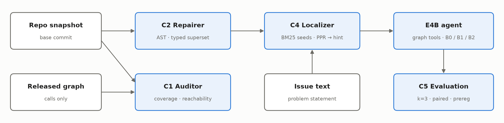
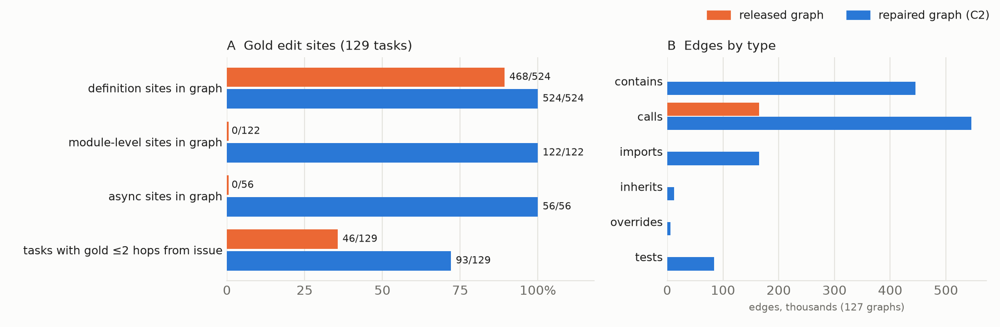

# Mind the Map: Auditing and Repairing the Released Code Graphs for Small Offline Coding Agents

*An exact audit of the Gemma 4 code graph, a drop-in typed repair that doubles edit-site reachability, and a pre-registered test on a 4B model.*

<!-- DRAFT v0.1 (Nov 4, 2026). Sections marked [PENDING PHASE 4] are filled after the Nov 10 00:00 UTC cutoff. Every number traces to notes/claims.md. -->

## Abstract

The code graph released with the Gemma 4 Developer Agent competition contains 0 of 65,415 async functions and 0 of 88,857 modules across its 127 graphs, and `calls` is its only edge type. We reconstruct its builder exactly (all 367,985 nodes explained) and audit it against Python AST ground truth: 18% of the definitions edited by the reference fixes are missing, including all 56 async ones, and only 35.7% of tasks have an edited site within two hops of a symbol named in the issue. We release a typed superset graph that keeps every released node and edge, loads unchanged in the competition harness, contains every edited definition and module, and **doubles two-hop reachability to 72.1%**. A graph localizer built on it beats grep (file Hit@10 75.0% vs 57.0%, p = 0.001) and matches BM25. We also publish a benchmark card: the public evaluation kit verifies only 39 of 129 reference fixes, and a documented environment raises this to 98. A pre-registered, multi-run evaluation of Gemma 4 E4B tests whether the repaired map helps an agent. [PENDING PHASE 4: one sentence of results.]

## 1. Introduction

Small coding agents spend much of their budget on localization: finding where to edit. The Gemma 4 Developer Agent competition gives every agent three graph tools (`get_code_neighbors`, `search_similar_code`, `get_code_subgraph`) over a pre-computed code graph with 256-d node embeddings.

Community reports suggest the tools have not helped. One ablation found agents with them solved 5 fewer tasks than a control, all 21 `search_similar_code` calls returned nothing, and 0 of 31 graph calls surfaced the gold file before the first edit [T1]. Another found no async functions [W1], which the hosts will not fix [H1]. Each finding covers a subset of the data, and none says *why* the tools fail or whether a better graph would help.

We answer three questions on all 129 tasks:

1. **What is in the map?** (§3) We reconstruct the builder exactly and measure coverage, edge semantics, and whether the code each reference fix edits is present and reachable.
2. **Can it be repaired without breaking the harness?** (§4) We build a typed superset that loads in the unmodified harness.
3. **Does a repaired map help?** (§5–6) We measure localization without a model under leave-one-repo-out tuning, then run a pre-registered agent evaluation with k = 3 runs per task, since 15% of tasks flip between identical runs [Z1].

*Figure 1. Components: audit (C1), repair (C2), localizer (C4), agent evaluation (C5).*

## 2. Data and setup

There are 129 tasks from four Python repositories (fastapi 67, rich 48, requests 13, httpx 1) at 127 base commits. Each commit has a graph (nodes with `id`, `name`, `text`; typed edges) and 256-d node vectors; each task has an issue, a reference ("gold") patch and validation tests. Everything ran on one Apple M5 laptop (24 GB) with Docker. A Kaggle notebook reproduces the audit tables byte for byte from the competition data.

**Benchmark card.** A task is locally verifiable if the gold patch passes its tests and an empty patch fails them. With the public wheelhouse only **39/129** tasks are (gold resolves 43, empty 4), mostly because four test dependencies are missing. We also found four harness behaviours that silently change results:
- a wheel cache that is never invalidated;
- version pins ignored under Docker (old fastapi commits get an incompatible Starlette);
- injected packages without `RECORD` files, so pip cannot replace them;
- a pytest plugin that imports the repo's *installed* package instead of the workspace, so an empty patch can "resolve" rich tasks. <!-- ⚠️ GAP: the 32/48 intermediate run log was not kept; re-run to quote it. -->

With a documented supplemental wheelhouse and per-repo test extras, **98/129** tasks are verifiable (fastapi 60, rich 38). The gold patch resolves 104 and the empty patch 6. All agent runs use this environment and the 98-task set. Local numbers are therefore not comparable to leaderboard numbers, whose environment is not public.

## 3. Auditing the released map

**Reconstructing the builder.** Node ids are dotted names, but the builder is not published. We matched every released node to a Python AST definition and found a rule that explains **all 367,985 released nodes across the 127 graphs, with none unexplained**. The rule:
- ids are rooted at the module path;
- classes are always placed at module scope;
- functions are filed under a single global "current class" that is cleared, not restored, when any class body ends.

Two side effects follow. 2,704 top-level definitions are filed under the wrong scope. And 9,111 AST symbols collide on a flattened id with another symbol, so the node text belongs to only one of them. We therefore check presence by id *and* text.

**Coverage (Table 1).**

| | in graph |
|---|---|
| top-level sync functions | 288,796 / 289,266 (99.8%) |
| classes | 63,810 / 63,831 (100.0%) |
| nested definitions | 19,856 / 26,877 (73.9%) |
| **async functions** | **0 / 65,415 (0.0%)** |
| **modules** | **0 / 88,857 (0.0%)** |
| edge types | `calls` only (452,588 edges), 13.1% of them class→method containment |

**Where the fixes are.** The 129 reference patches edit 573 definition-level sites (524 enclosing definitions plus 49 edits in brand-new files, which no base-commit graph can contain) and 122 module-level sites, which the graph cannot hold because it has no module nodes. Only 468 of the 573 definition-level sites (81.7%) are in the graph. All 56 async sites are missing, and 20 of the 129 tasks touch at least one async function. Seeding with symbols named in the issue (an issue token equal to a node's last name component, fan-out ≤ 50) and walking the graph undirected, a gold site is reachable within 1, 2 and 3 hops for 31.0%, 35.7% and 49.6% of tasks. The 3-hop figure independently matches a community measurement of 47.9% [A1].

**Embeddings.** The harness's `search_similar_code` accepts only a node id, never text, which explains the empty semantic searches in [T1]: the tool cannot be queried from an issue description. Nor can an agent build the query vector itself, because the 256-d vectors are not a public text encoder's output: against EmbeddingGemma's 256-d truncation of the node text (one commit, 4,263 nodes), median cosine is ≈ 0 for three prompt formats.

## 4. Repairing the map (C2)

We rebuild each commit's graph from its source snapshot with Python's `ast`, as a **strict superset** of the released graph. Every released node id, `name`, `text` and edge (including its key) is kept unchanged, so any agent behaviour that depends on the released graph is preserved. We add:

- **nodes:** modules (with their first 40 lines as text), async functions, and the remaining missing definitions, each with `kind`, `file` and `line`;
- **typed edges:** `contains` (module→class→method), `calls`, `imports`, `inherits`, `overrides`, and `tests` (test function → non-test symbol it references).

Name resolution is static and conservative. It follows imports (including relative imports and re-exports), `self`/`cls` and `super()`, but never guesses the target of a call on an unknown receiver. As a result our own `calls` edges reproduce only part of the released name-matched `calls` edges; because released edges are always kept, the repaired graph never loses one. <!-- ⚠️ GAP: measure calls recall over all 127 graphs into a results file before quoting a number. -->

**Gate results (Table 3).**

| | released → repaired |
|---|---|
| superset violations | 0 over 127 graphs |
| gold definition sites in graph | 468/524 (89.3%) → 524/524 (100%) |
| module-level gold sites | 0/122 → 122/122 |
| async gold sites | 0/56 → 56/56 |
| gold within 2 hops of issue seeds | 46/129 (35.7%) → 93/129 (72.1%); 88/129 (68.2%) without `contains` |
| nodes / edges | 367,985 / 452,588 → 529,769 / 1,256,926 |

The repaired graphs load with the harness's own `load_graph_from_json` (127/127), and `get_code_neighbors` with `edge_type` returns typed neighbours where the released graph returns none. Examples: the containing module of an async route handler, the subclasses of `APIRoute`, and the base method that `HTTPBasic.__call__` overrides. New nodes have no stored vector and get the harness's zero vector, so `search_similar_code` cannot rank them.

*Figure 2. Released vs repaired graph. A: reference-fix edit sites present in the graph, and tasks with one within two hops of an issue symbol. B: edges by type; the repaired `calls` count includes all released edges.*

## 5. Localizing with the map (C4)

**Method.** C4 ranks files and symbols with Personalized PageRank over the symmetric typed adjacency. The restart distribution mixes identifier seeds with the top-20 BM25 nodes for the issue text. Hyperparameters are chosen **leave-one-repo-out** on file Hit@5, so a repo's predictions never use parameters tuned on that repo:
- damping α ∈ {0.3, 0.5, 0.7};
- seed mix ∈ {0, 0.5, 1};
- 32 subsets of edge types, with `calls` always included.

Baselines: grep over code-like identifiers in the issue, BM25 over files and nodes, and 2-hop expansion on the released and repaired graphs.

**Results (Table 2, 128 tasks with a localizable gold file; exact McNemar, exploratory, unadjusted).**

| method | file@1 | file@5 | file@10 | sym@5 | sym 2-hop@5 |
|---|---|---|---|---|---|
| grep | 27.3 | 49.2 | 57.0 | – | – |
| BM25 | 27.3 | 56.2 | 71.1 | 39.8 | 75.8 |
| 2-hop, released | 29.7 | 43.8 | 47.7 | 26.6 | 51.6 |
| 2-hop, repaired | 31.2 | 50.0 | 56.2 | 31.2 | 66.4 |
| C4, released | 32.0 | 63.3 | 79.7 | 27.3 | 82.8 |
| C4, repaired | 30.5 | 61.7 | 75.0 | 32.8 | 79.7 |

- **The repair raises what an agent sees through the neighbour tool:** 2-hop symbol reachability rises from 51.6% to 66.4% (22 vs 3 discordant tasks, p < 0.001).
- **C4 beats grep** at file@5 (31 vs 15, p = 0.026) and file@10 (33 vs 10, p = 0.001), and is level with BM25 (p = 0.27 and 0.44). Its file ranking is the same on either graph (p = 0.83); leave-one-repo-out picked `calls`+`contains` in every fold, so the added edge types did not enter file ranking; an agent reaches them through neighbour queries, tested in §6.
- **Agreement is a usable confidence signal.** When C4's and BM25's top files agree (42 tasks), C4's Hit@1 is 47.6%, against 22.1% otherwise. This was found after looking at the results, so §6 uses it only as an exploratory label.

## 6. Does the map help an agent? A pre-registered evaluation

**Design.** The design was registered in a git commit made before any agent run (`notes/prereg.md`, commit `cf3908b`; the repository is published with this paper). All configurations use Gemma 4 E4B (Q4_K_M via llama.cpp) with identical prompts, sampling (temperature 1.0, top-p 0.95), budgets (50 tool calls, 30 minutes) and harness. Only the graph-related tools differ:

- **B0:** no graph tools and no code-analyzer sub-agent.
- **B1:** the starter submission's graph tools over the released graph.
- **B2:** as B1, over the repaired graph, with a C4 hint prepended to the issue. The hint gives the top-5 files and top-10 symbols, labelled high confidence when C4 and BM25 agree on the top file, low otherwise.

Tasks come from the 98 verifiable tasks, in a fixed hash-based order stratified by repo, with k = 3 runs per (configuration, task) and runs interleaved by task.
- **Primary outcome:** per-task solve rate, comparing B2 vs B0 and B2 vs B1. Holm correction; paired task-level bootstrap CIs; exact McNemar on (task, run) pairs.
- **Secondary, descriptive only:** tool calls, turns until the agent first reads a gold file, and a failure taxonomy (amendment 1).

**Amendments.** Both amendments are logged in the same file with timestamps and the outcomes visible when they were written.
- *Amendment 1* added the failure taxonomy as a descriptive outcome: resolved, harness error, no patch, broken syntax, broken import, hang, tests fail. It was written after 8 discarded smoke and timing runs failed, 5 of them because the agent broke its own edit.
- *Amendment 2* fixed a stop date (Nov 10, 00:00 UTC) after the observed pace (~19 min per run, against 4.7 planned) showed that the registered N = 84 could not finish before the deadline. The primary analysis covers the tasks whose 9 runs all finished by the cutoff.

**Results.** [PENDING PHASE 4: Table 4 — solve rate ± 95% CI per config; B2−B0 and B2−B1 effect with CI and Holm-adjusted p; tool calls; turns to first gold-file read; failure taxonomy per config; B2 by confidence label. Report N as observed.]

## 7. Related work

**Repository graphs for agents.** LocAgent localizes over a heterogeneous graph with containment, import, invocation and inheritance relations [L1]; CodexGraph exposes a graph database to the agent [C1]; RepoGraph adds a line-level dependency graph [R1]; OrcaLoca [O1] and CoSIL [C2] search call graphs. Our repair adopts their typed-edge view and adds `tests` edges. Our contribution is a measurement of a *released* graph against ground truth, and a superset that stays compatible with an existing harness.

**Lexical localization.** Agentless shows simple hierarchical localization is competitive [A2]. Here, the first identifier-grep hit is correct for 30% of tasks and 35 of 128 issues name no code identifier [J1], consistent with BM25 being hard to beat.

**Ranking and noise.** C4 uses Personalized PageRank [P1] with lexical restart. Single-run agent scores swing by several points [B1] and 15% of tasks flip between identical runs here [Z1], which motivates k = 3, paired tests and pre-registration.

We thank the competitors whose public findings this work checks and extends: Ayush Thakur [T1], Jason Wold [W1], Ali Hassan [A1], Hitarth Jain [J1] and Ruijie Zhu [Z1].

## 8. Limitations

- Four repositories, two of them dominant (fastapi and rich make up 115 of 129 tasks). The leave-one-repo-out folds for httpx (1 task) and requests (13) are small.
- Static resolution misses dynamic calls, so the repaired `calls` relation has partial recall.
- The agent study uses one small model with 4-bit weights and a local environment that differs from the competition's scoring environment.
- The agent study stops at a fixed date (amendment 2), so its N is smaller than registered.

## 9. Conclusion

[PENDING PHASE 4: 1–2 sentences.] The released map is missing whole symbol kinds and all structural relations, and its embeddings cannot be reached from text. A typed superset fixes coverage and doubles reachability without touching the harness, and the exact builder reconstruction lets anyone repeat the audit on future releases.

**Resources.** Code (Apache 2.0, [github.com/saurin16/mind-the-map](https://github.com/saurin16/mind-the-map)), typed-graph additions, labels and tables as a public Kaggle Dataset ([saurinpatel16/gemma4-swe-typed-graphs](https://www.kaggle.com/datasets/saurinpatel16/gemma4-swe-typed-graphs); no Competition Data, rebuilds the full graphs from it), and a public Kaggle notebook that reproduces Table 1 from the competition data ([saurinpatel16/mind-the-map-c1-code-graph-audit](https://www.kaggle.com/code/saurinpatel16/mind-the-map-c1-code-graph-audit)).

## References

<!-- Refs checked Nov 4 via web search. ⚠️ GAP: C2 author list not confirmed (Zhejiang University); LocAgent venue not confirmed, cited as arXiv. -->

- [T1] A. Thakur. Graph-tool ablations. Kaggle discussion 746250, Gemma 4 Developer Agent competition, 2026.
- [W1] J. Wold. Data audit of the code graphs. Kaggle discussion 742911, 2026.
- [H1] E. Markowitz (host). Note on async functions. Kaggle discussion 745998, 2026.
- [A1] A. Hassan. Code-graph bug localization benchmark. Kaggle notebook `alikalwar/code-graph-bug-localization-benchmark-gemma-4-pap`, 2026.
- [J1] H. Jain. Can grep find the bug? Kaggle notebook `hitarthjain0/gemma-4-agent-can-grep-find-the-bug`, 2026.
- [Z1] R. Zhu. Run-to-run variance. Kaggle discussion 747168, 2026.
- [B1] B. H. Bjarnason, A. Silva, M. Monperrus. On randomness in agentic evals. arXiv:2602.07150, 2026.
- [L1] Z. Chen, X. Tang et al. LocAgent: Graph-guided LLM agents for code localization. arXiv:2503.09089, 2025.
- [C1] X. Liu et al. CodexGraph: Bridging large language models and code repositories via code graph databases. NAACL 2025. arXiv:2408.03910.
- [R1] S. Ouyang et al. RepoGraph: Enhancing AI software engineering with repository-level code graph. ICLR 2025. arXiv:2410.14684.
- [O1] Z. Yu, H. Zhang, Y. Zhao, H. Huang, M. Yao, K. Ding, J. Zhao. OrcaLoca: An LLM agent framework for software issue localization. ICML 2025 (PMLR 267). arXiv:2502.00350.
- [C2] CoSIL: Issue localization via LLM-driven iterative code graph searching. ASE 2025. arXiv:2503.22424.
- [A2] C. S. Xia et al. Agentless: Demystifying LLM-based software engineering agents. arXiv:2407.01489, 2024.
- [P1] T. Haveliwala. Topic-sensitive PageRank. WWW 2002.
